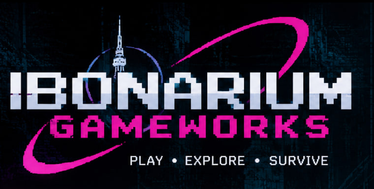
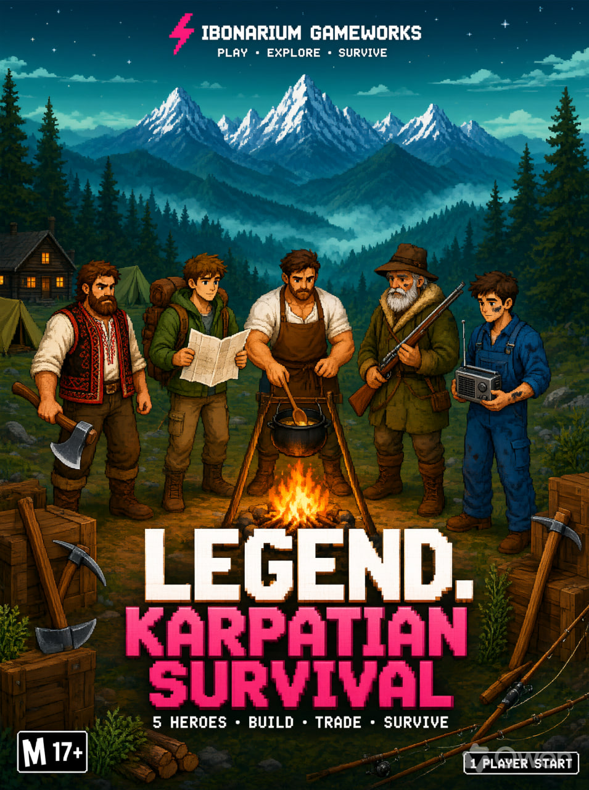

# VIKTOR LEGEND 2: КАРПАТИ — TABOR SURVIVAL

**Частина 2** саги IBONARIUM. Продовження «IBONARIUM: KYIV — THE LAST SIGNAL»
(перша частина: https://lavandaaudit.github.io/legend_v5/).

Гра — чиста статика: **ОДИН ФАЙЛ `index.html`** у корені (CSS, усі 9 JS-модулів
та PNG-активи першої частини у base64 вбудовані всередину, нуль зовнішніх
запитів). Працює офлайн, подвійним кліком, у прев'ю та на будь-якому хостингу.

## ПРО ГРУ

**Грати онлайн:** <https://lavandaaudit.github.io/legend2_v2/> — або просто подвійний клік на `index.html` (гра в одному файлі, працює офлайн).

**VIKTOR LEGEND 2: КАРПАТИ — TABOR SURVIVAL** — продовження «IBONARIUM: KYIV — THE LAST SIGNAL». Після подій у місті група ЛЕГЕНДИ виїжджає в Карпати: місто більше не тримає — тримають гори, вогнище і бринза. Відкритий гірський світ: полонини, хребти, Черемош, озеро, три села (Верховинка, Криворівня, Тустань), скелі Довбуша, хребет Піп-Іван і хата Мольфара.

- **ГРУПА 5 ГЕРОЇВ** (з першої частини): ЛЕГЕНДА (лідер, йде першим), TOXIC (кухар — готування дужче), PABLO (рибалка — клює частіше), DIIN (майстер — будівництво дешевше), ROCK (весельчак — гулянки частіше). Йдуть гуртом, імена світяться над головами.
- **СЕЛА ЗСЕРЕДИНИ:** у кожну хату, церкву, крамницю, корчму, ковальню й садибу можна ЗАЙТИ (E на дверях; вихід — E біля ЖОВТОЇ СТРІЛКИ на порозі / ESC / кнопка ✖ ВИХІД): піч гріє, стіл годує, свічки — молебень, прилавок — торг.
- **ГУЛЯНКА КОЛИ ЗАВГОДНО (Q):** вогнище + вся група; 8 фаз на 8 годин — ТАНЦІ → БАЙКИ → ГРИБНИЙ ТРІП → ПОПАДАЛИ → ЖАЛІБНИЙ ТРІП → РОЗГУЛ → ПОХМІЛЛЯ — у кожної СВОЯ музика, світло і п'яні глічі; на гулянці МОЖНА ХОДИТИ — герої танцюють, падають, встають.
- **МАНДРІВКИ (T):** ГОВЕРЛА (2061 м), ПЕТРОС, ПІП-ІВАН («Білий Слон»), МАРМАРОСЬКІ АЛЬПИ, озера НЕСАМОВИТЕ / ЯЙКО / СИНЕВИР, кордон РУМУНІЇ і МОЛДОВИ, авто-експедиція на ШАЦЬКІ ОЗЕРА. Сходження — окремий режим У ІЗОМЕТРІЇ: серпантин, УСЯ ГРУПА ЙДЕ, хмари у три шари — з ~62% підйому йдеш НАД МОРЕМ ХМАР.
- **ФОТОАЛЬБОМ:** на кожній точці — ФОТОСЕРІЯ з 3 полароїдів (УСІ РАЗОМ / СТРИБОК! / ПРАПОРЕЦЬ); зберігається разом з грою, «Карпатський Тиждень» платить за серії.
- **ЗВІРІ ТА НІЧ:** у лісі крадеться РИСЬ, над полонинами КРУКИ, уночі КАЖАНИ летять на фонарики; погода: сонце / хмарність / вітер / туман / дощ / град / сніг / ХУРТОВИНА; без вогню вночі замерзаєш.
- **«5 Г» — НІЧ П'ЯТИ ЗІРОК:** таємний гриб + табір ввечері — у КОЖНОГО героя свій тріп, після — бачення: цілий день артефакти світяться на карті.
- **ГРАФІКА:** власний 16-bit піксель-арт студії IBONARIUM GAMEWORKS, ізометрія 2:1, карпатська палітра; доба ≈ 11 хвилин реального часу. Модерація: M — MATURE 17+.

## АСЕТИ

Офіційні jpeg-активи з репозиторію — вони ж відображаються ПІД ГРОЮ на сторінці гри (секція «ПРО ГРУ ТА АСЕТИ»).

**Логотип студії — `assets/logo.jpg`** (IBONARIUM GAMEWORKS — PLAY • EXPLORE • SURVIVE):



**Плакат гри — `assets/poster.jpg`** («LEGEND. KARPATIAN SURVIVAL» — 5 HEROES • BUILD • TRADE • SURVIVE):



> Файл `1.jpg` у корені репозиторія — точна копія `assets/poster.jpg`
> (однаковий md5 `ef2323b30ec71b211c09cea0d8c6fc10`) — можна видалити.

## Повний склад пакунка

```
index.html          — ВЕСЬ ГРА В ОДНОМУ ФАЙЛІ (публікується на GitHub Pages)
.nojekyll           — щоб GitHub Pages не чіпав файли
README.md           — цей файл
CHANGELOG.txt       — повний список фіч + патчі
index.dev.html      — джерело розробки (теги <script src>)
style.css           — стиль консолі IBONARIUM / HUD / панелей
js/                 — 9 модулів розробки:
   palette.js         палітра + піксель-хелпери + час
   audio.js           WebAudio: SFX і мелодії
   v5assets.js        PNG-активи ПЕРШОЇ ЧАСТИНИ у base64 (генерується)
   sprites.js         герої (пропорції v5, 5 кольорів), гуцули, тварини
   world.js           генерація Карпат (Чорногора, Ґорґани, Мармароси)
   ents.js            група, селяни, тварини, риби, доручення
   sys.js             виживання, погода, ГУЛЯНКА, «5 Г», квести, сейв
   gfx.js             ізо-рендер, погода, ніч/вогонь, тріп, полароїди,
                        ІЗО-СХОДЖЕННЯ (хмари, серпантин, група йде)
   main.js            цикл, керування, панелі, магазини, мандрівки
assets/             — 47 PNG першої частини (Kenney CC0): дачі, цегляні хати,
                      крамниця, гараж, авто ВАЗ/Lanos/SUV/Truck, дерева,
                      кущ, паркан, ліхтар, гірські валуни
                      + ЛОГОТИП І ПЛАКАТ ГРИ:
   logo.jpg             логотип студії IBONARIUM GAMEWORKS
                        («PLAY • EXPLORE • SURVIVE») — з репозиторія legend_2_v1
   poster.jpg           офіційний плакат «LEGEND. KARPATIAN SURVIVAL»
                        (5 HEROES • BUILD • TRADE • SURVIVE) — з репозиторія legend_2_v1
tools/
   build_inline.py    перезбірка index.html зі style.css + js/
   gen_v5assets.py    генератор js/v5assets.js з PNG у assets/
```

> Гравцю потрібен ТІЛЬКИ `index.html`. Решта — для розробки й повторного
> використання активів.

## Швидкий старт

```bash
python3 -m http.server 8080     # необов'язково
# відкрий http://localhost:8080  або просто подвійний клік на index.html
```

Старт: після екрана BIOS клікни/тапни будь-де → меню → **НОВА ГРА**.

## Як запушити в НОВИЙ репозиторій (GitHub Pages)

```bash
# 1. створи новий порожній репозиторій на GitHub (наприклад legend_karpaty)
# 2. розпакуй архів — вміст папки legend_karpaty/ кладемо в корінь репо:
cd legend_karpaty
git init
git add -A
git commit -m "VIKTOR LEGEND 2: КАРПАТИ — v2.4 «ФІНАЛ — ВЕРШИНА»"
git branch -M main
git remote add origin https://github.com/<ТВІЙ-НІК>/legend_karpaty.git
git push -u origin main
# 3. увімкни Pages:
#    Settings → Pages → Build and deployment →
#    Source: «Deploy from a branch» → Branch: main / Folder: / (root) → Save
# 4. гра буде тут:
#    https://<ТВІЙ-НІК>.github.io/legend_karpaty/
```

Варіант Б (як перша частина): скопіююй `index.html` у папку `legend_v6/`
репозиторію `lavandaaudit.github.io` — гра буде на
`https://lavandaaudit.github.io/legend_v6/`.

> Не мішай файли частин в одній папці — index.html у частин різні.

## Розробка

```bash
# правиш js/ чи style.css → перезбираєш одиночний файл:
python3 tools/build_inline.py
# змінив PNG у assets/ → перегенеровуєш base64-модуль:
python3 tools/gen_v5assets.py
```

Для дев-запуску з окремими файлами: `python3 -m http.server 8080` з кореня
і відкрий `index.dev.html`.

## Керування

| Клавіша | Дія |
|---|---|
| WASD / стрілки | рух (у воду — плавання) |
| SHIFT | біг |
| E | дія: збір, рубка, двері, діалоги, рибалка; у приміщенні біля ЖОВТОЇ СТРІЛКИ (двері) — вийти на вулицю |
| M / I | багаж і крафт |
| TAB | велика карта (клік = маршрут) |
| Q | гулянка (коли завгодно: вогнище палає + вся група тут). v2.3: ХОДИТИ МОЖНА — герої танцюють навколо вогню, 8 фаз на 8 годин (ТАНЦІ → БАЙКИ → ГРИБНИЙ ТРІП → ПОПАДАЛИ → ЖАЛІБНИЙ ТРІП → РОЗГУЛ → ПОХМІЛЛЯ), музика/світло/глічі міняються щогодини, падають і лежать |
| R | 🔊 ГУКАТИ: група кричить «АУ!» — загублені біжать на голос швидше, ніж самі дійшли б; пробивають хащі |
| F | 🔦 фонарики на ніч (кажани летять на світло) |
| B | ⛺ ТАБІР будь-де: похідний намет на лугах/лісі/полонині (E біля табору → вогнище і будови) |
| T | МАНДРІВКИ: СХОДЖЕННЯ У ІЗОМЕТРІЇ — гора з терасами (ліс → полонина → скелі → сніжники), серпантин, вся група ЙДЕ і штурмує вершину, хмари у три шари; озера, кордони, Шацькі (ван на ізо-трасі). На кожній точці — ФОТОСЕРІЯ з 3 кадрів (УСІ РАЗОМ / СТРИБОК! / ПРАПОРЕЦЬ) у альбом |
| G | група (доручення, фонарики, пошук) |
| J | журнал |
| 1–4 | їсти / пити / спати / відпочити |
| V | повний екран |
| ESC | збереження (у приміщенні — вийти на вулицю) |

Мобільно: віртуальний джойстик + кнопки E/RUN/MAP/BAG/ГРУПА/ТРЕКИ/🔊 ГУКАТИ/🔦 ФОНАР/⛺ ТАБІР/ГУЛЯНКА;
діалоги й панелі завжди ПОВЕРХ кнопок, інфоблоки стиснуті під телефон.

## Кредити

Активи першої частини (будівлі, авто, дерева, реквізит) —
[Kenney](https://kenney.nl), ліцензія CC0 1.0. Гра кодом: піксель-арт
малюється прямо на canvas, PNG — у base64 всередині index.html.

---
© IBONARIUM GAMEWORKS • Київ • 17.11.2026 • v2.4 «ФІНАЛ — ВЕРШИНА»
• LAVANDA AUDIT IBONARIUM COSMO DYNAMICS LAB LIVE
